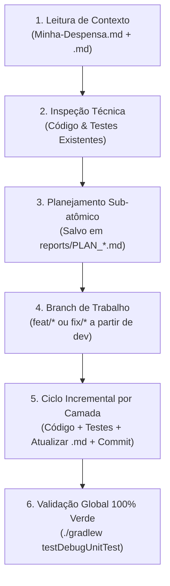

# 🧭 Minha Despensa — Documento Norteador de Engenharia e Contexto

> **Atenção para Agentes de IA e Desenvolvedores:**  
> Este documento é a **fonte primária e norteadora** de governança, arquitetura e convenções do projeto **Minha Despensa**.  
> **Para recuperar e entender o contexto completo da aplicação**, a IA ou desenvolvedor **DEVE OBRIGATORIAMENTE LER este arquivo (`Minha-Despensa.md`)** e, em seguida, os arquivos de contexto específicos de cada módulo impactado na raiz de seus respectivos diretórios:
> - [`core/core.md`](core/core.md) — Camada de Domínio Puro, Casos de Uso, Modelos e Regras de Negócio.
> - [`data/data.md`](data/data.md) — Persistência Room KMP (Schema v9), SQLite, Migrations, DAOs e Repositórios.
> - [`uisystem/uisystem.md`](uisystem/uisystem.md) — Design System (Glassmorphism), ViewModels, Telas, Máquinas de Estado e Componentes Compose Multiplatform.

---

## 🎯 1. Visão Geral do Produto e Propósito

O **Minha Despensa** é uma aplicação **Kotlin Multiplatform (Android & iOS)** desenvolvida com arquitetura **Local-First** (offline-first). O aplicativo unifica o ciclo completo de abastecimento, despensa doméstica, histórico de preços e controle orçamentário familiar:

```text
Catálogo de Produtos ──► Lista de Compras ──► Finalizar Compra (Checkout Atômico)
                                                    │
                              ┌─────────────────────┴─────────────────────┐
                              ▼                                           ▼
                       Estoque na Despensa                         Histórico de Preços
                              │
                              ▼
                     Consumo & Controle de Validade
                              │
                              ▼
                    Orçamento & Reposição Familiar
```

### Decisões Fundamentais de Produto:
1. **Local-First por Padrão:** O SQLite local (`BundledSQLiteDriver` via Room KMP) é a única fonte da verdade autoritativa imediata. A aplicação funciona com 100% de seus recursos offline.
2. **Ciclo Unificado e Transacional:** Ao finalizar uma compra no supermercado, os itens marcados são debitados da lista, inseridos como lotes ativos na despensa e registrados no histórico de preços por meio de uma transação SQLite imediata e atômica.
3. **Gestão Orçamentária e Valoração:** O usuário define tetos orçamentários mensais e acompanha em tempo real o valor financeiro do estoque estocado e as despesas consolidadas do mês e ano.
4. **Sincronização em Nuvem & Despensas Compartilhadas (Protocolo v2.1):** Arquitetura Local-First híbrida com suporte a autenticação individual (JWT login/registro), multi-despensas (`Household`) e sincronização bidirecional resiliente baseada em Outbox e Last-Write-Wins (LWW), permitindo o compartilhamento em tempo real de produtos, lotes e listas entre familiares via código de convite de 8 caracteres.
5. **Distribuição Autônoma de Atualizações In-App (Self-Hosted OTA):** O aplicativo conta com verificação e download de novas versões (APK) hospedadas no servidor próprio Domus, com acompanhamento de progresso de download e acionamento do instalador nativo Android (`FileProvider`). No iPhone (iOS), a funcionalidade é automaticamente e completamente ocultada da interface.
6. **Suporte, Relato de Bugs In-App e Coleta de Diagnósticos:** Sistema integrado para envio proativo de relatos pelo usuário (bugs, sugestões, dúvidas), recuperação e envio de falhas não tratadas (crashes de sessões anteriores gravados em `pending_crash.txt`), e exportação de logs sanitizados capturados em buffer circular em memória (1500 entradas) via OS Share Sheet e API REST multipart (`/api/v1/support/bug-reports`).

---

## 🏛️ 2. Arquitetura do Sistema e Divisão de Módulos

O projeto adota estritamente os princípios de **Clean Architecture**, **MVVM (Model-View-ViewModel)** e **Fluxo de Dados Unidirecional (UDF)**:

```text
┌───────────────────────────────────────────────┐
│                  :composeApp                  │  Ponto de entrada (Android/iOS), bootstrap do Koin
└───────────────────────┬───────────────────────┘
                        ▼
┌───────────────────────────────────────────────┐
│                   :uisystem                   │  Compose Multiplatform, Design System Glassmorphism,
│                                               │  Telas, ViewModels, Máquinas de Estado (SubFlow)
└───────────────────────┬───────────────────────┘
                        ▼
┌───────────────────────────────────────────────┐
│                     :core                     │  Domínio puro: Modelos, Use Cases, Contratos
│                                               │  Zero dependências em UI ou Banco de Dados
└───────────────────────▲───────────────────────┘
                        │ implementa
┌───────────────────────┴───────────────────────┐
│                     :data                     │  Persistência Room KMP (Schema v9), SQLite Bundled,
│                                               │  DAOs, Entidades, Mappers, Pipeline de Migrations
└───────────────────────────────────────────────┘
```

### Responsabilidades por Módulo:

* **[`:core`](core/core.md):** Contém todas as regras de negócio puras, entidades de domínio serializáveis (`@Serializable`), exceções localizadas em português, use cases independentes e contratos de repositório. Não importa Android, iOS, Room ou Compose.
* **[`:data`](data/data.md):** Implementa os contratos de repositório de `:core`. Gerencia o Room Multiplatform com driver nativo SQLite (`BundledSQLiteDriver`), entidades, DAOs, conversores, pipeline de migrações SQLite (v1 até v9 com saltos diretos) e concorrência LWW (*Last-Write-Wins*) com carimbo de data/hora (`updatedAt`).
* **[`:uisystem`](uisystem/uisystem.md):** Apresentação visual multiplataforma em Compose. Contém o Design System proprietário com estética Glassmorphism ([`PrimaryContainerGlassCard`](uisystem/src/commonMain/kotlin/com/bitlabbr/minhadespensa/uisystem/components/core/card/PrimaryContainerGlassCard.kt), [`SecondaryContainerGlassCard`](uisystem/src/commonMain/kotlin/com/bitlabbr/minhadespensa/uisystem/components/core/card/SecondaryContainerGlassCard.kt)), tokens tipográficos, padrão `UiText`, integração de hardware (CameraX + ML Kit para leitura de código de barras EAN) e ViewModels com `StateFlow`.
* **`:composeApp`:** Orquestração da inicialização da aplicação, injeção de dependências via Koin (`DataModule`, `UiModule`) e ciclo de vida multiplataforma.

---

## 🏷️ 3. Padrão Obrigatório de Commits (Conventional Commits)

Todos os commits no repositório devem seguir estritamente a especificação **Conventional Commits**:

```text
<tipo>(<escopo>): <descrição clara em inglês ou português no imperativo e minúsculo>
```

### 3.1. Tipos Permitidos:
* **`feat`**: Nova funcionalidade, novo caso de uso, nova tela ou expansão de contrato.
* **`fix`**: Correção de bug, falha de validação ou comportamento inesperado.
* **`test`**: Adição, expansão ou atualização de testes automatizados unitários ou de integração.
* **`docs`**: Atualização de documentação (`Minha-Despensa.md`, `<module_name>.md`, README, Wiki).
* **`refactor`**: Refatoração interna de código que não altera o comportamento externo nem adiciona funcionalidade.
* **`perf`**: Otimização focada exclusivamente em performance ou alocação de memória.
* **`chore`**: Atualizações de dependências, build scripts (`build.gradle.kts`), Gradle ou infraestrutura.

### 3.2. Escopos Padronizados:
Utilize sempre o nome do módulo ou do subsistema afetado:
* `(core)`: Regras de negócio, use cases, models e repositórios abstratos.
* `(data)`: Banco Room, DAOs, migrations, entidades, mappers SQLite.
* `(uisystem)`: Telas, ViewModels, componentes, design system ou formatadores de UI.
* `(composeApp)`: Bootstrap, Koin modules, targets de plataforma.
* Sub-escopos específicos quando aplicável: `(catalog)`, `(pantry)`, `(shopping)`, `(home)`, `(budget)`.

*Exemplos de commits corretos:*
* `feat(core): add DeleteProductCategoryUseCase with cascading fallback to Outros`
* `fix(data): rename timestamp to updatedAt in migration 8 to 9`
* `feat(uisystem): add live currency transformation to SetMonthlyBudgetDialog`
* `test(core): add unit tests for category duplicate validation`
* `docs(data): document schema v9 and direct migration jumps in data.md`

### 3.3. Atomicidade Sub-atômica dos Commits:
* Cada commit deve representar **uma única unidade lógica de trabalho compilável e testada**.
* **Evite mega-commits misturando camadas:** primeiro commite o domínio com seus testes (`core`), depois a persistência com seus testes (`data`), e então a UI/ViewModel com seus testes (`uisystem`).
* **Compilável a cada passo:** Qualquer commit da branch deve compilar com sucesso e ter todos os seus testes passando.

### 3.4. Higiene Rigorosa do Git:
* ❌ **NUNCA commitar:** Arquivos de sessão temporários de IA (ex: históricos, prompts, logs transitórios), arquivos de cache (`.gradle`, `build/`, `.idea/`, `.DS_Store`).
* ✅ **SEMPRE commitar:** Código de produção, testes automatizados e a documentação atualizada do módulo.

---

## 🧪 4. Obrigatoriedade Absoluta de Testes Automatizados

O projeto mantém uma postura de **tolerância zero para código não testado ou regressões**.

### 4.1. Regras Mandatórias para Novas Features e Alterações:
1. **Toda nova funcionalidade DEVE vir acompanhada de testes unitários automatizados:**
   * **Camada de Domínio (`:core`):** Testes unitários para novos casos de uso e regras de negócio cobrindo o caminho feliz (happy path) e todos os casos de borda/erro (validação nula, vazia, limites de tamanho, formato inválido).
   * **Camada de Dados (`:data`):** Testes com banco SQLite in-memory para novos DAOs, entidades, migrações de schema, regras de LWW (*Last-Write-Wins*) e transações imediatas.
   * **Camada de Apresentação (`:uisystem`):** Testes de ViewModel utilizando `StandardTestDispatcher`, testando emissões de `UiState`, transições de máquinas de estado (`SubFlow`), validação de formulários e filtros de busca reativos.
2. **Atualização Imediata de Testes Existentes:**
   * Se um contrato de repositório ou caso de uso for alterado legitimamente (ex: adição de novo método ou parâmetro), os testes existentes e os fakes de teste (`FakeCatalogRepository`, `FakePantryRepository`, etc.) de todos os módulos **DEVEM ser atualizados imediatamente**.
   * **É terminantemente proibido:** Comentar testes falhos, suprimir falhas com `@Ignore` sem justificativa do usuário, ou apagar testes para "fazer o build passar".
3. **TDD para Correções de Bugs (Bugfixes):**
   * Antes de corrigir um bug, reproduza o problema através de um teste unitário que falhe.
   * Aplique a correção no código de produção até que o teste passe, assegurando que o bug nunca mais reapareça (teste de regressão permanente).
4. **Portão de Qualidade (Quality Gate):**
   * **100% dos testes devem passar:** Antes de finalizar qualquer tarefa ou abrir Pull Request, a suíte de testes completa do projeto deve rodar e passar sem nenhuma falha:
     ```bash
     ./gradlew testDebugUnitTest
     ```

---

## 📚 5. Atualização Contínua dos Arquivos de Contexto (`.md`)

A documentação do repositório não é estática; ela é uma **documentação viva sincronizada com o código**.

### 5.1. Regra de Sincronia a Cada Interação / Commit:
* **Sempre que uma alteração estrutural for feita em um módulo**, o arquivo `.md` correspondente na raiz daquele módulo DEVE ser atualizado:
  * Modificações em regras de negócio, novos models, use cases ou contratos ➔ Atualizar [`core/core.md`](core/core.md).
  * Modificações no banco de dados, novas tabelas, colunas, migrations, DAOs ou mappers ➔ Atualizar [`data/data.md`](data/data.md).
  * Modificações em telas, novos componentes de Design System, ViewModels ou fluxos de UI ➔ Atualizar [`uisystem/uisystem.md`](uisystem/uisystem.md).
  * Modificações em convenções globais, novos módulos ou padrões do projeto ➔ Atualizar [`Minha-Despensa.md`](Minha-Despensa.md).
* **A documentação deve ser incluída no mesmo commit (ou etapa sub-atômica) da alteração correspondente**, garantindo que o histórico do Git preserve o código e seu contexto sincronizados em cada revisão.

---

## 🤖 6. Protocolo de Ação para Agentes de IA

Sempre que um agente de IA iniciar uma sessão de desenvolvimento, correção de bug ou implementação de feature neste repositório, deve seguir o seguinte roteiro estrito:



1. **Recuperação de Contexto:**
   * Ler este arquivo: [`Minha-Despensa.md`](Minha-Despensa.md).
   * Ler os arquivos de contexto dos módulos que serão alterados: [`core/core.md`](core/core.md), [`data/data.md`](data/data.md), [`uisystem/uisystem.md`](uisystem/uisystem.md).
2. **Diagnóstico da Demanda:**
   * Identificar o problema, arquivos impactados e os testes existentes correspondentes.
3. **Planejamento Sub-atômico:**
   * Dividir a tarefa em etapas modulares (geralmente: Domínio ➔ Dados ➔ Apresentação).
   * Documentar o plano em `reports/PLAN_<TASK_NAME>.md` detalhando arquivos alterados, novos testes e commits previstos.
4. **Execução com Disciplina:**
   * Implementar o código da etapa.
   * Criar ou atualizar os testes unitários da etapa e rodar localmente (`./gradlew :<modulo>:testDebugUnitTest`).
   * Atualizar o arquivo `<module_name>.md` da camada alterada.
   * Realizar o commit sub-atômico no padrão Conventional Commits.
5. **Validação Final:**
   * Rodar toda a suíte de testes do projeto (`./gradlew testDebugUnitTest`).
   * Garantir que 100% dos testes passam e que a árvore de trabalho (`git status`) permaneça limpa.

---

## 🌿 7. Padrão de Branches

As branches de trabalho devem ser criadas sempre a partir da branch base `dev`:
* **Novas Funcionalidades:** `feat/<numero-da-issue>-<descricao-curta-em-kebab-case>`  
  *Exemplo:* `feat/77-custom-product-categories`
* **Correções de Bugs:** `fix/<numero-da-issue>-<descricao-curta-em-kebab-case>`  
  *Exemplo:* `fix/81-pantry-movement-schema-migration-v8-v9`
* **Refatorações:** `refactor/<descricao-curta-em-kebab-case>`  
  *Exemplo:* `refactor/reorganize-pantry-mappers`
